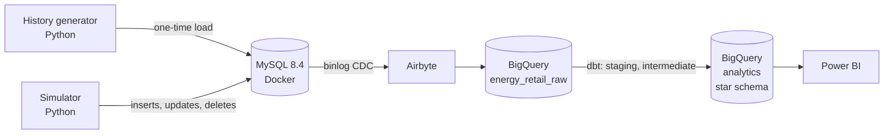

# Energy retail ELT: an end-to-end modern data stack project

A data pipeline for a fictional German energy supplier: an operational MySQL database with live contract, meter reading and invoice activity, replicated into BigQuery with Airbyte change data capture, and modeled into a tested star schema with dbt for reporting in Power BI.

> **Status:** in progress. Setup stage; the source database and its data are being built.

## Architecture



| Layer | Tool | Role |
|---|---|---|
| Source (OLTP) | MySQL 8.4 in Docker | Normalized supplier database with enforced keys |
| Activity | Python simulator | New contracts, status changes, price changes, readings, invoices, deletes |
| Extract + load | Airbyte (self-hosted) | Binlog-based CDC into BigQuery |
| Warehouse (OLAP) | BigQuery | Raw and modeled data |
| Transform | dbt Core | Staging, intermediate and mart models with tests and docs |
| BI | Power BI | Dashboard on the star schema |

## Data

The supplier is invented, so customers, delivery points, contracts, tariffs and invoices are synthetic. They are generated with a fixed seed, so the same data can be rebuilt.

Consumption is based on real sources:

- [BDEW standard load profiles](https://www.bdew.de/energie/standardlastprofile-strom/), which German suppliers use for customers without a smart meter.
- 15-minute readings from 38 households with heat pumps in Lower Saxony, 2019, from the [WPuQ dataset](https://zenodo.org/records/5642902) (CC BY 4.0). They are the supplier's smart meter customers on a heat pump tariff.

A simulator keeps adding activity on top, so the pipeline handles changing data rather than a static file.

## Repository layout

```
docker-compose.yml     MySQL source database with CDC settings
mysql/init/            Schema and Airbyte user, run on first start
scripts/               History generator and simulator
dbt/                   dbt project (staging, intermediate, marts)
```

## Running it

Requirements: Docker Desktop, Python 3.12, a Google Cloud project with BigQuery.

Setup steps: coming soon.

## Design decisions

**Why the source database runs in Docker.** The MySQL database stands in for the supplier's production system, so it should behave like one: a fixed version (MySQL 8.4), its own settings, and nothing installed on my laptop that could clash with other projects. Docker gives exactly that. `docker-compose.yml` describes the whole setup in one file: the MySQL version, the port, the binlog settings that change data capture needs, and a volume so the data survives restarts. Anyone can start the same database with `docker compose up -d`, and `docker compose down -v` resets it to empty. Airbyte runs in Docker too, so the whole extract and load side stays off the host system.

More decisions are added as the project progresses.
